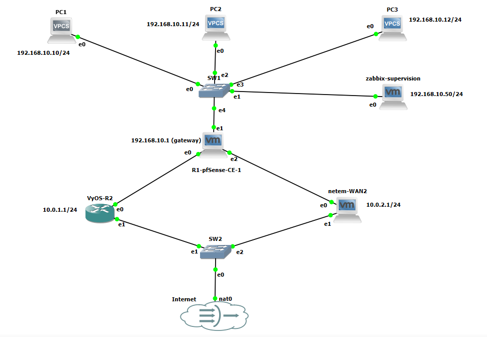

# Banc d'essai Starlink MultiWAN

## Description du projet

Ce projet vise à valider la mise en place d'une architecture MultiWAN avec bascule automatique entre deux liens Internet (Starlink et un lien dégradé simulé via Netem). L'objectif est de mesurer le **RTO (Recovery Time Objective)**, de valider la **QoS (priorisation VoIP)** et d'observer le comportement du réseau en cas de coupure.

## Architecture



### Plan d'adressage

| Équipement | Interface | Adresse IP | Rôle |
| :--- | :--- | :--- | :--- |
| pfSense | LAN | 192.168.10.1/24 | Pare-feu / Routeur principal |
| pfSense | WAN1 | DHCP | Lien Starlink |
| pfSense | OPT1 | DHCP | Lien Netem (WAN2) |
| VyOS-R2 | eth0 | 10.0.1.1/24 | Routeur FAI simulé |
| VyOS-R2 | lo | 172.16.99.1/32 | Loopback OSPF |
| netem-wan2 | ens33 | 10.0.2.1/24 | Simulation réseau dégradé |
| netem-wan2 | ens37 | DHCP | Lien vers pfSense |
| zabbix-supervision | ens33 | 192.168.10.50/24 | Supervision |

### Caractéristiques techniques des machines

| Machine | OS | CPU | RAM | Disque |
| :--- | :--- | :--- | :--- | :--- |
| pfSense | pfSense CE | 2 vCPU | 2 Go | 20 Go |
| VyOS-R2 | VyOS 1.4 | 1 vCPU | 1 Go | 10 Go |
| netem-wan2 | Debian 12 | 1 vCPU | 1 Go | 10 Go |
| zabbix-supervision | Ubuntu 22.04 | 2 vCPU | 4 Go | 40 Go |

### Caractéristiques de la machine hôte

| Composant | Caractéristique |
| :--- | :--- |
| **Processeur** | Intel Core i7 (ou AMD Ryzen 7) - 8 cœurs |
| **Mémoire RAM** | 16 Go DDR4 |
| **Disque** | SSD NVMe 512 Go |
| **Système d'exploitation** | Windows 11 (hôte) |
| **Hyperviseur** | VMware Workstation Pro 17 |
| **Réseau** | Carte Ethernet Gigabit |

## Prérequis

- GNS3 (pour la topologie réseau)
- VMware ou VirtualBox (pour les VMs)
- pfSense CE
- VyOS
- Debian (pour Netem) 
- Ubuntu (pour Zabbix)
- python 3.10 (Scripts de mesure RTO)

## Installation et Reproductibilité

1. Cloner ce dépôt :
   ```bash
   git clone https://github.com/LielMakosso/starlink-multiwan-testbed.git
   ```
2. Configurer chaque équipement en se référant au dossier configs/

3. Lancer les scripts de test depuis le dossier Scripts/

##  Commandes de lancement des tests

### Mesure du RTO (depuis zabbix-supervision)
```bash
python3 scripts/rto_monitor.py --target 8.8.8.8 --interval 0.5 --output results/rto_demo_live.csv
```
### Simulation de coupures périodiques (depuis netem-wan2)
```bash
sudo ./scripts/periodic_outage.sh ens37 2 15 5
```
### Profil réseau dégradé (depuis netem-wan2)
```bash
tc qdisc replace dev ens37 root netem delay 80ms 25ms distribution normal loss 5%
```

### Restauration du profil normal
```bash
tc qdisc replace dev ens37 root netem delay 40ms 10ms distribution normal loss 1%
```

### Résultats
| Test | RTO Moyen | Perte de paquets | Observations |
| :--- | :--- | :--- | :--- |
| Profil Normal | ~16 s | 1% | Bascule fluide, VoIP priorisé |
| Profil Dégradé | ~15.85 s | 5% | Latence plus élevée |
| Coupures Périodiques | ~8.43 s | Variable | Bascule répétée |

### TCO (Coût Total de Possession)
- Logiciels : 0 FCFA (tous Open Source)
- Matériel : Machine hôte avec 16 Go RAM, 4 vCPU
  
